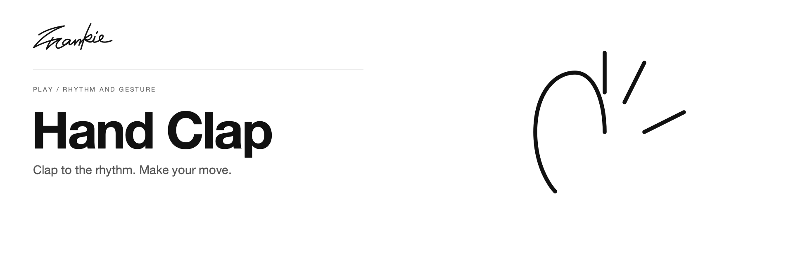

# Hand Clap

[English](README.md) · [简体中文](README.zh-CN.md)

Follow the beat, read your opponent, and choose a gesture before the next move.

[Guide](docs/guide.md) · [Run locally](#run-locally)

## What it does

- Play the three-beat rhythm with charging, attack and defense gestures.
- Manage player and opponent energy across different move strengths.
- Adjust rhythm speed with the on-screen control.

## Run locally

Serve the directory with Python 3:

```sh
python3 -m http.server 8000 --bind 127.0.0.1
```

Open http://localhost:8000. There is no package-install or build step.

## Before you start

Gesture play needs camera permission and a loaded hand-recognition model. P5.js, P5.sound and ml5 load from external CDNs. The banner uses the original interface hand guide, not a camera image.

## For developers

Check model loading, the permission flow, rhythm controls and gameplay against the local server. Source-file roles are described in the [project guide](docs/guide.md).

[Project guide](docs/guide.md) · [Artwork](docs/readme/README.md)

---

Made by [Songhai Fan](https://github.com/SonghaiFan) · A Frankie project
