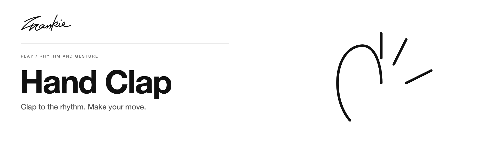

# Hand Clap

[English](README.md) · [简体中文](README.zh-CN.md)

跟随节拍，观察对手，在下一拍前选择手势。

[项目指南](docs/guide.md) · [本地运行](#本地运行)

## 可以做什么

- 通过蓄力、攻击与防御手势进行三拍节奏对战。
- 根据不同招式的强度，管理自己与对手的能量。
- 使用屏幕上的控件调整节奏速度。

## 本地运行

使用 Python 3 启动静态服务器：

```sh
python3 -m http.server 8000 --bind 127.0.0.1
```

打开 http://localhost:8000。无需安装依赖或构建。

## 开始之前

手势游戏需要摄像头权限，并加载手部识别模型。P5.js、P5.sound 和 ml5 从外部 CDN 加载。Banner 使用原界面中的手势说明，没有摄像头画面。

## 开发说明

在本地服务器上检查模型加载、权限流程、节奏控件与对战。源码分工见[项目指南](docs/guide.md)。

[项目指南](docs/guide.md) · [Banner 维护](docs/readme/README.md)

---

由 [Songhai Fan](https://github.com/SonghaiFan) 制作 · Frankie 系列项目
